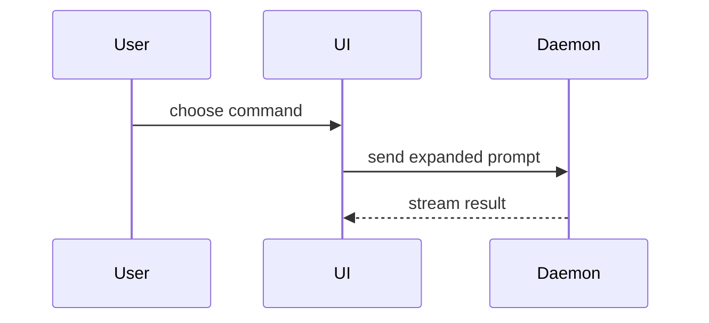

Use this template for writing the PR body:

```markdown
## Summary

<diagram, diff-sketch, or tree>

## Evidence

- **Before:** <screenshot/output/failing test run>
  **After:** <screenshot/output/passing test run>

## Merge Danger

**Door:** <one-way or two-way>

<optional: description>

**Blast Radius:** <one-word description>

<optional: potential ramifications of merge>
```

<!-- needs: written by tools/add-needs.mjs for AI Blocks; not part of the original skill. Edit that tool, not this section. -->
## Before you start
Use the material below to do this job. If facts or tool access are missing, explain what you can finish and what must wait.

**What you need** (use your own material or the linked skill):
- **A code change** (yours): a change to the code, with what it fixes and how it was checked.

**Makes it better (optional):**
- **A test report** (yours): what was tested, what passed, what failed and why.

**Recommended steps before this one** (optional; do each once, then reuse what it makes):
1. **A test report** with the [Code change test coverage reviewer](https://useaiblocks.com/skills/test-gap-finder). Bring a code change, a codebase, a test report (optional).
2. This one.

How to start:
1. **Look first.** Use what they've already attached, pasted or put in their about-me note. In a coding assistant with file access, look in the project too for these by name.
2. **Check what's missing.** Look for a code change, a test report. They can attach files, paste the details, or share a file path your assistant can read. Offer the linked skills above when they help prepare that material. Ask only for missing facts that change the result. If they ask you to start with what they have, complete the parts you can and mark the gaps.
3. **Do the job.** Follow the skill below with the facts and tools you have. Mark each gap with `MISSING:` where it belongs and never invent a fact to fill it.
<!-- /needs -->

## Sections

Skip all preambles and keep prose brief. Use the user's domain language from `GLOSSARY.md` if the user pastes one; otherwise use the terms in the diff.

### Summary

Pick the smallest view that makes the key point clear.

- Show logic or an algorithm as pseudocode:

```text
on(save)
  if content is unchanged
    return cached result
  write new content
  return fresh result
```

- Show runtime control flow as a call tree:

```text
submitForm
  createSession
    persistPrompt
    launchAgent
  navigateToSession
```

- Show UI structure as a component tree, including state and module boundaries that matter:

```text
<SessionPage> (apps/example/src/routes/session.tsx)
  useSessionEvents()
  <SessionToolbar>
    <RunSkillButton> (packages/ui)
```

- Show file responsibility or a broad refactor as a shallow file tree:

```text
src/
├── commands/       # parses user actions
├── sessions/       # owns session state
└── transport/      # sends API requests
```

- Show component interaction, control flow, or data flow with Mermaid:



- Use `diff` when the point is what changes and the surrounding shape already exists. Match the diff shape to the topic.

For a component change:

```diff
 <SessionPage>
   useSessionEvents()
   <SessionToolbar>
+    <RunSkillButton />
   <SessionTimeline>
+    <SkillResultCard />
```

For a file-layout change:

```diff
 src/
 ├── commands/
+│   └── show-me.ts       # expands the slash command
 ├── sessions/
-└── transport.ts
+└── transport/
+    ├── client.ts
+    └── stream.ts
```

For a call-tree or call-stack change:

```diff
 submitForm
   createSession
     persistPrompt
+    expandSkillMention
     launchAgent
-  navigateToSession
+  navigateToSession
+    subscribeToEvents
```

For a state or control-flow change:

```diff
 on(save)
-  write content
+  if content is unchanged
+    return cached result
+  write new content
+  invalidate cache
```

- Show the whole block when most of it is new, when omitted context would hide ownership or order, or when the user needs a copyable target shape:

```ts
function expandSkill(command: string): string {
  const skillName = command.slice(1);
  return `use the ${skillName} skill`;
}
```

#### Guidance

Place each visual next to the short text it supports. Keep only the calls, files, props, states, and boundaries needed to answer the user's current question or the options to resolve the current discussion point.

You may use one of these, you may use several, it is unlikely you will use all of them. Use your judgement and don't overwhelm the user.

### Evidence

Concrete evidence that the change works. Show a before and after.

If the user has not supplied real before and after output, write "Evidence: missing" and do not invent test results, output or screenshots.

Screenshots are S-tier - when the environment is set up for it and the change is visual.

Execution-based evidence is A-tier. Test results, console output. Show the exact test that now fails and passes, using pseudocode.

### Merge Danger

Describe whether it's a one-way or two-way door. You can walk back through two-way doors, but not one-way doors. A PR that is cheap to roll back is lower risk. Changes that involve destructive actions or hard-to-reverse decisions are one-way doors.

The blast radius is the potential impact or scope of the changes introduced by this PR. Consider all possibilities. Examples are layout shift, breakages for consumers, mobile responsiveness, etc.

<!-- next: written by tools/add-needs.mjs for AI Blocks; not part of the original skill. Edit that tool, not this section. -->
## After this
When you've handed it back, suggest what they could do next in one short question. It's a suggestion: if they're done, that's fine. Offer these, and say they can type their own:
- The [Software developer from specifications](https://useaiblocks.com/skills/spec-builder). It takes the document.
If they pick one and that skill is added here, carry straight on with what you just made. If not, give the link and say what to bring.
<!-- /next -->
