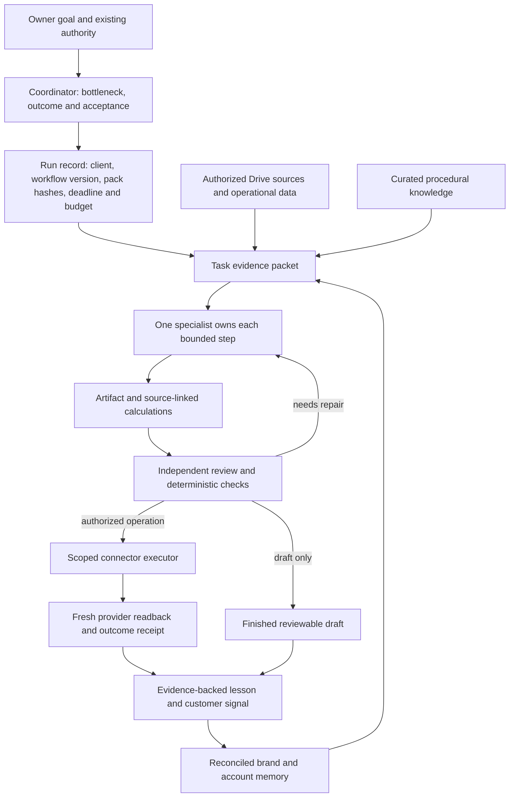

# E-commerce agent workflows: memory, evidence and deployment

Owner request: useful end-to-end work for a founder, a commerce team or an agency, with easy installation and a shared deployment option. Success means a correct, useful artifact or verified business operation with a traceable outcome. More agents, more retrieved text and a successful API response are not success measures by themselves.

## Product paths

| Path | What the user gets | Current implementation boundary |
|---|---|---|
| Session pack | A specialist, its methods, knowledge, tools and task context, used in the user's chosen AI host | File execution, child agents, connectors and persistence depend on that host. No automatic cross-host memory or shared-account authority |
| Local workspace | A deterministic installation of the existing workflow framework into a new client folder | `build-specs/kit/bootstrap.mjs` installs files and verifies hashes. It does not install all specialist packs, authenticate connectors, enable hooks or spend on models |
| Shared team service | Jobs, evidence, artifacts, status and approved execution available to authenticated teammates | Existing marketplace durable model-run infrastructure is reusable. A complete multi-client connector executor, provider adapters and authenticated shared workflow runtime remain implementation work |

Use a subscription host for the current trials. Do not silently convert a user's chat subscription into paid API use. A future unattended runtime must disclose and verify its provider, billing and capability requirements before activation. The local bootstrap is deliberately useful without any model credentials.

## Operating architecture

This is the target shared execution architecture, not a statement that every node is deployed. The existing board, gate, trace, knowledge tools and org-context ledger supply reusable parts. A coordinator routes a whole job to one specialist when that is enough. Split work only where branches can proceed independently or an independent reviewer improves an observed failure mode.

Every step specifies its owner, required inputs, allowed output paths, fixed decisions, expected artifact, deterministic checks, review rubric, deadline, retry bound and stop condition. A returned artifact is checked against those requirements before a dependent step starts. A child never inherits broader account or client permissions merely by being delegated work.

## Four platform buyers

Lindsey owns Meta, Raymond Google, Kelsey Snapchat and Zara TikTok. Jared owns cross-channel allocation. Dustin implements the approved Meta launch plan and copy; Ploy's TikTok Shop operations are separate from paid buying. Shared role workflows apply these named owners only inside the e-commerce team.

Each buyer keeps operating memory under `context/media-buying/<platform>/<account-id>/`. Shared brand identity, product evidence and approved claims can be reused. Account budgets, currencies, attribution windows, creative permissions, campaign IDs and approvals remain scoped. Never sum attributed purchases across platforms as unique store orders. Read platform capability and current object state before proposing or executing a change.

## Memory architecture

| Memory | Contents | Admission and retrieval rule |
|---|---|---|
| Procedural | Versioned skills, workflows, public knowledge cards | Keep conditions, counterexamples and source attribution. A tutorial is not a merchant's current business data |
| Core instructions and rules | Role, precedence, approved operating boundaries, completion contract | Version in host instructions and pack contracts; retrieved documents cannot grant authority or override these rules |
| Semantic: brand and account facts | Identity, tone, exact design tokens, product facts, policy qualifications, account settings | Reuse the existing org-context ledger and owner resolutions. Preserve source/date/scope; an owner correction or revocation supersedes stale projections |
| Episodic: experience | Completed experiments, decisions, failure reasons, customer complaints, lessons | Save evidence and applicable conditions. A self-written reflection is a hypothesis until its outcome is verified |
| Working state | Brief, retrieved packet, stage state, artifacts, unresolved questions, spend/time | Bind to one client and run. Resume from persisted verified state; do not rely on the chat transcript as the only job database |

Memory selection must include exclusions: discontinued offers, expired rights, revoked preferences and unknown claims. A packet compiled from a reconciled memory view is invalid when the underlying facts, offers, scope or owner-resolutions files change. Never retrieve raw historical facts as though they were the current reconciled memory.

For agencies, authorized users resolve client scope on the server before any retrieval. Keep private source storage, retrieval indexes, credentials, operational memory, jobs and approvals separate per client. Share only explicitly reusable procedural knowledge. A folder layout, scope string or prompt is not an authenticated tenancy boundary.

## Source and retrieval lifecycle

1. Inventory authorized folders with stable Drive IDs, names, MIME types, revision/modification metadata and pagination state. Keep inaccessible, unsupported and unparsed entries visible. A folder listing is not proof of semantic ingestion.
2. Reconcile local source bytes, extraction versions, hashes and source registry entries. Reuse existing work. Distinguish intentionally rejected/zero-card sources, private licensed material and missing ingestion.
3. Parse structure before indexing. Preserve headings, tables, units, timestamps, qualifications and links. Record embedded images or failed OCR as unresolved. Giant transcript paragraphs need bounded windows with source locations; never read arbitrary multi-megabyte paragraphs into a single prompt.
4. Search a concise curated card layer first. If a decision needs more detail or a qualification is missing, retrieve the relevant original passage from the authorized private corpus. Do not ship purchased or private originals in public downloads.
5. Break a compound task into evidence requirements: for example margin, attribution, stock, customer need and platform availability. Retrieve support for each requirement, deduplicate repeated evidence and preserve the source conditions. Lexical matches and a nonempty result do not establish that a requirement is answered.
6. Compile a bounded task packet with citations, source hashes, scope, freshness, conflicts and missing evidence. Prefer useful coverage over blindly increasing top-k. Never silently cut off a policy exception to fit the budget.
7. Verify arithmetic against source records and review factual claims against retrieved evidence. If evidence is stale, contradictory or missing, finish the useful bounded draft and identify exactly which decision remains unresolved.
8. On source changes, invalidate affected projections and packets. In a shared service, use an incremental sync job and deletion/revocation tombstones. Automatic Drive delta sync is a deployment requirement, not currently established by the manual inventory audit.

The current Drive audit found 256 source documents corresponding to local downloads and registry entries by normalized filenames and sizes. This does not verify remote byte hashes or prove every image/table has been understood. The local full-source corpus remains private. Source-to-card accounting and each of the 76 agents' module access are tracked separately from retrieval quality.

### Role-first retrieval

Every ecommerce specialist has a D2C role contract: supported outcomes, primary ecomOS modules, evidence requirements and conditional cross-role dependencies. The hosted runner inserts it in the system instructions. Downloaded packs carry readable instructions and a machine-readable module configuration. Neither a listed source path nor a role description counts as retrieved evidence.

Filter procedural knowledge by role before indexing or reading source bodies. Start with five results, retain primary brand/account facts in their own authorized scope, and expand for a named missing evidence need. Explicit module/path requests take priority. A weak default search may broaden visibly; an explicit narrow scope must not silently broaden. Preserve source qualifications and report gaps even when all five result slots are filled. Role filtering is a relevance optimization, not an authorization boundary.

Three alternating local runs over the private source corpus reduced reads from 256 documents / 22,641,432 bytes to 71 documents / 7,158,157 bytes for a measurement/finance/Google scope. Median local pipeline time was 6,489.88 ms versus 2,127.60 ms. Independent review still found only three directly useful passages, two conditional and one marginal, with forecast evidence missing. This measures local resource savings; it does not establish higher answer quality or lower model cost.

Subsequent error analysis found that extra corroborating passages crowded out a later decision under a tight budget. The repaired selector prioritizes uncovered decision terms before further corroboration. Independent root review of the unchanged role-scoped task found five directly useful passages and one conditional/noisy passage; the specific 13-week cash horizon remained missing. Splitting distinct forecast and supplier decisions into separate facets restored it in a separately labeled development trial. The earlier failure is retained, and neither trial establishes exhaustive retrieval.

A separate public-index test for the SEO specialist indexed 43 of 2,091 cards. Median cold parsing/indexing was 38.00 ms versus 953.01 ms; search was 0.95 ms versus 10.33 ms. Both still fetched the full 4,955,304-byte JSON response. Per-module network payloads, token billing savings and end-to-end user latency are not established by this test. Retrieval-quality gates must accompany performance gates so restrictive routing cannot pass by becoming fast but incomplete.

Forty of the existing 75 golden questions map to exact ecommerce job roles; 35 do not and are not included in this role comparison. On identically reconstructed public packs, adaptive role routing and full search both achieved expected-reference Hit@5 of 21/40 (52.5%). MRR@5 changed from 0.41625 to 0.42875, with two rank improvements, one rank regression and five visible broad fallbacks. This development comparison does not validate historical claims as current facts, and its misses remain a quality concern. A separate three-run Lindsey lookup measured median 965 ms versus 1,569 ms and about 51% fewer indexed-source bytes. No model token-cost saving was measured.

A proposed blanket discount for toolbox guidance improved the development set but was rejected. In 20 separately authored questions, reference-section overlap hits fell from 17/20 to 9/20: factual cases improved from 8/10 to 9/10 while procedural cases fell from 9/10 to 0/10. The author learned the candidate policy after selecting source sections, so this is not fully blinded authorship; it is still a clear regression that blocks promotion. Source type alone cannot determine relevance. The shipped candidate retains the original weighting.

## Initial end-to-end workflows

| Workflow | Steps and owners | Acceptance |
|---|---|---|
| Paid-growth bottleneck | Margaret scopes the business constraint; finance/measurement establish comparable metrics; Jared coordinates independent Lindsey/Raymond/Kelsey/Zara analyses; one owner joins the findings | Source-backed contribution and stock constraints, no double-counted attribution, a prioritized decision with the cost of doing nothing and an executable bounded plan |
| Creative to verified launch | Customer evidence and brand packet; creative concept; actual production; independent visual/product/copy review; platform buyer; authorized launch execution; results review | Distinct customer arguments, correct product identity, usable exports/edit sources, exact approved change, provider IDs/readback and separate evidence of delivery |
| SEO and answer visibility | Source/website inventory; technical and demand evidence; strategy; implementable page/schema/content changes; rendering and measurement checks | Current primary sources, website-specific decisions, working artifacts and measured results; unsupported capabilities stay explicit |
| Retention and customer learning | Consent/policy/product memory; drafts and flow configuration; event/exit tests; local or provider execution; complaint pattern review | Correct consent, suppression and policy qualifications; outbox is not delivery; recurring product/manual problems reach the responsible human owner |
| Inventory and cash | Demand, returns, lead time and cash snapshot; deterministic calculations; sourcing plan; permitted operational change; follow-up | No mismatched periods or units, no unapproved purchase orders, stock/readback and a dated review rule |

The existing process files define many more stages and roles. Onboarding starts with one valuable complete workflow, not activating all 76 agents. An agency reuses a process template but gets a separate source packet, budget and acceptance record for each client.

## Deployment and recovery requirements

- Local bootstrap never overwrites an existing workspace. Keep its file receipt; run `node agent/bootstrap.mjs doctor`. It verifies local files only and always reports that hosted readiness is unverified.
- Test the actual host's tools and enforcement adapter before enabling writes. The bundled Claude hooks are not automatically supported in ChatGPT or Codex. Portable packs remain useful for draft work when execution is unavailable.
- Persist run and stage versions. Use leases or equivalent concurrency control so two workers cannot publish the same action. Do not use the current file board as a concurrent multi-tenant database.
- Retry transient reads with a bound. Reconcile ambiguous writes using durable operation IDs/idempotency keys and provider readback. Unknown success is not a failed action that can safely be repeated.
- Reuse valid existing authorization within its scope. Ask for a concrete missing decision only after the reviewable plan is prepared. Approval must be tied to the authenticated actor and exact action/version, not inferred from a model-authored sentence.
- Provide pause/cancel and a visible unresolved-work queue. Do not claim cancellation reverses a completed external action. Retain failure causes and customer signals so successful symptom automation does not hide a product problem.

## Evaluation and release

The current implementation increment contains these 20 improvements. Each is a mechanism to test, not a claim of industry leadership:

| # | Improvement | Verification target |
|---|---|---|
| 1 | D2C responsibilities and outcome contracts for all 76 roles | Hosted model inputs and downloaded instructions preserve each specialist's methods |
| 2 | Separate Meta, Google, Snapchat and TikTok buyers | Correct platform owner, account scope, workflow and team handoff |
| 3 | Role-first public card indexes | Same-query relevance and candidate count, with scope visible |
| 4 | Role-first local source reads | Unrelated module bodies are not read; explicit cross-role lookup works |
| 5 | Multi-need retrieval and bounded context | Evidence for several decisions survives the context budget |
| 6 | Complete small procedures and qualified excerpts | Prerequisites, exceptions and omitted sections remain visible |
| 7 | Original-source task packets | Exact source hashes, locations and read status accompany each passage |
| 8 | Curator metadata exclusion | Routing headers cannot outrank substantive source text |
| 9 | Drive/local/card coverage reconciliation | Missing ingestion stays distinct from deliberately excluded sources |
| 10 | Typed memory selection | Working, semantic, episodic and procedural records obey separate admission rules |
| 11 | Reconciled semantic memory and invalidation | Corrections, revoked offers and changed underlying files invalidate stale views |
| 12 | Shared brand evidence contract | Exact tokens, voice examples, customer evidence, asset rights and data definitions stay sourced |
| 13 | Structured financial evidence selection | Complete selected records and units reach calculation tools; large arrays require structured queries |
| 14 | Scoped evidence and sensitive-data handling | Cross-client/account records and secrets do not enter packets; limitations stay explicit |
| 15 | Deterministic calculations and comparable performance checks | Claims bind to source records and comparable measured runs |
| 16 | Actual media and rendering checks | Native assets, visible product fidelity, concept diversity and rendered styles are inspected |
| 17 | Execution/readback contracts | A draft, local simulation, provider acceptance and delivered outcome remain distinct |
| 18 | Safe repeatable local installation | New client workspaces, inactive hooks, complete dependencies and file receipts |
| 19 | Automation-debt principles and customer feedback | Visibility, judgment, skill and relationship signals survive automation |
| 20 | Version-bound output evaluation and release gates | Preserve first failures, independently review artifacts and prevent stale results from certifying new code |

Separate parsing completeness, retrieval coverage, memory correctness, artifact usefulness, connector execution and business outcomes. Use representative questions with multiple required passages, corrections/revocations, conflicting sources, missing account data and cross-client distractors. Compare retrieval at similar context budgets; more context alone can explain a gain. Keep first failures and do not silently regrade an old artifact after a source fix.

For execution, test restart/resume, partial success, duplicate delivery, cancellation, source changes mid-run, unauthorized cross-client access and independent provider readback. Human review samples should check customer meaning, brand fidelity and costly decisions. Preserve exposure to customer and supplier feedback rather than optimizing only response speed.

The completed earlier 76-agent candidate scored 59 PASS, 8 NEEDS_REPAIR and 9 LIMITED_CAPABILITY under provisional independent AI review. Supplemental development trials are separate. These numbers do not certify this newer implementation or establish superiority to a human team, Codex or Claude Code. Production remains subject to actual output and integration gates.

## Engineering basis

### Ecommerce deliverable upgrades after the foundation

Review of [NotFair](https://github.com/nowork-studio/notfair-plugin), pinned at `deed0436d0c68cbc20a78523fffc67edd12aa25c`, informed the following implementation. Its hosted MCP backend is not included in that repository and has not been installed or authenticated here. Adapted shipped materials carry the source's MIT notice. Historical source policy thresholds are not treated as current platform facts.

- Meta and Google audit methods preserve the actual account, window, attribution, rows fetched and coverage denominator. They calculate contribution economics explicitly and no longer infer duplicate purchases or a corrected ROAS from an unexplained platform/store count difference.
- Creative, landing-page and CRO methods require the finished requested artifact and a traceable connection from customer evidence through product claims, creative, destination and purchase journey. Product/variant/stock/shipping examples replace generic lead-generation examples where the role serves a D2C store. Screenshots and write receipts describe observed checks, not claimed conversion improvement.
- Material interventions use the existing canonical job history, with baseline, accepted change, independently inspected readback, mature outcome and guardrail evidence. The optional local validator checks consistency; it neither authenticates connector responses nor proves causal improvement or promotes a lesson.
- The existing SEO specialist gains an ecommerce release-regression workflow covering theme, catalogue, variant, feed and market changes. It retains the reviewed baseline, quantifies sampled coverage, checks product-to-cart consistency and separates expected changes, verified regressions and missing evidence. No blanket facet canonicalization or discontinued-product redirects are prescribed.
- Reddit acquisition and LinkedIn wholesale/corporate-gifting acquisition extend the ecommerce team to 78 specialists. These roles judge channel fit and feasible economics before recommending spend, and require platform-specific source definitions. A missing connector produces an honest export-backed plan or draft, not a fabricated campaign launch. Wholesale outcomes follow qualified companies through quotes, orders and contribution rather than optimizing cheap leads.

The new roles do not replace the original 76-agent historical evaluation denominator. The next paired evaluation includes all current roles, with the same GPT Sol generator model, common merchant inputs and host capabilities in both the specialist and plain-Sol arms. Sol and Terra independently judge actual artifacts. New-role cases, Gehna-backed work and synthetic/public work are reported separately. Passing implementation tests is a prerequisite for those trials, not an output-quality result.

### Optional ontology experiment

Review of [Omnigraph](https://github.com/ModernRelay/omnigraph), source commit `6fc2f823621ee37784066a6fae51b2f8e8ad131e`, adds query-first identity and relationship rules to the shared memory contract. Product/variant/media identity, scoped provider keys, sourced assertions, owner decisions and time-qualified policies remain distinct. Session reflection proposes a small evidence-backed change with golden queries and negative controls; it cannot automatically rewrite the schema or promote a lesson. An agent-authored valid schema is not evidence of 80% semantic correctness.

The implementation does not install Omnigraph or replace canonical memory. A private synthetic, no-provider graph experiment is separate from the fixed agent-output comparison. Any future adapter must derive from pinned source and owner-resolution state, pass cross-scope and revocation tests, and demonstrate better required-evidence retrieval on matched tasks. Omnigraph's native data branches and main-only schema application are different review paths; a Git PR and tested migration would be our schema deployment process. Hosted tenant isolation, graph lifecycle cost and retrieval advantage remain to be verified before adoption.

The cached Stanford course manifest covers all 14 slide PDFs linked on the course page at the audit date, 1,284 pages. The implementation applies selected principles; it does not reproduce or claim validation by the course.

- [CS329Z lecture 3](https://web.stanford.edu/class/cs329z/slides/lecture03.pdf), pages 11-13, 24, 32 and 50: just-in-time evidence, chunk boundaries, multi-level retrieval and reranking. Our local implementation uses lexical retrieval and bounded source expansion, not an unimplemented dense-vector service.
- [Lecture 6](https://web.stanford.edu/class/cs329z/slides/lecture06.pdf), pages 10, 30 and 70: explicit workflow control, composable patterns and progressive context disclosure.
- [Lecture 7](https://web.stanford.edu/class/cs329z/slides/lecture07.pdf), pages 9-10 and 20: preserving procedure, knowledge and progress across sessions, with distinct procedural memory.
- [Lecture 8](https://web.stanford.edu/class/cs329z/slides/lecture08.pdf), pages 10-14 and 31: separate orchestration, communication and coordination; add agents only where their benefit exceeds coordination and information-loss costs.
- [Standard Agent Specification v0.2.0](https://standardagentspec.org/): explicit providers, effects, threads, tools and child-agent context. Portable declarations are not a conforming runtime or access-control enforcement.
- [Hamel Husain and Shreya Shankar's evals FAQ](https://hamel.dev/blog/posts/evals-faq/): use observed failure analysis and human-calibrated evaluation to choose improvements rather than announcing an unsupported multiplier.
