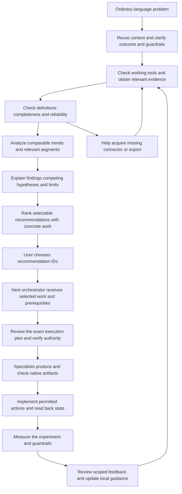

# Outcome delivery in the user's AI

The product carries a user from an undesirable starting state toward an agreed, measurable desired state. It owns the bridge: evidence, analysis, recommendations, the selected plan, implementation, experiments and feedback. The host AI supplies the model, tokens, connected tools and actual work. AI Blocks supplies reusable methods and checked contracts.

Business results remain intended until measured. Delivering a checked change, observing an improvement and establishing causation are separate claims.

## Conversation and work lifecycle

1. Preserve the original request. A reported symptom is not a verified trend or cause.
2. Reuse relevant chat, attachments, local brand/project context, existing methods and accepted artifacts. Ask only unanswered questions that change the job.
3. Define the desired outcome, primary metric, baseline or unknown baseline, commercial/technical guardrails and allowed work. For acquisition work, distinguish purchase CPA from new-customer CAC and contribution economics.
4. Inspect existing read connections and available dates before requesting access. Gather the task's needed inputs. A database repair does not need a marketing brief.
5. Check sources, time zones, attribution, freshness, pagination, nulls, totals and collection changes. Record actual checks, scope and limitations. Continue useful bounded analysis when some evidence is partial.
6. Analyze the right periods and cross-sections. Use weighted totals, competing explanations and contribution/mix analysis where appropriate. A descriptive correlation does not establish a cause or an intervention's expected uplift.
7. Produce a decision brief plus ranked recommendation cards. Each card is attached to specific work with native outputs and checks. Explain evidence, uncertainty, tradeoffs, requirements, fallback and measurement. Do not invent ten recommendations when fewer are supported.
8. The user chooses IDs. Prepare a dependency-aware execution proposal for our next orchestrator. Keep unselected work deferred and disclose prerequisite work. Selection does not expand external-action authority.
9. Retrieve full selected role remits and methods. Prepare the exact existing specialist/team plan, preserve review gates and carry accepted inputs into implementation. Reuse existing authorization without repeatedly asking.
10. Produce actual editable artifacts, check and repair them, and execute covered actions with real tools. Read back external state. Reconcile uncertain responses before retrying. A paused campaign draft, checked code patch and live deployed change remain different states.
11. Register a realistic experiment and measurement rule. Preserve volume, value, profit, safety or other guardrails alongside the primary metric. Keep inconclusive and negative outcomes.
12. Review feedback, scope it, update local instructions/examples and regression cases, and use it on the next relevant job. This is not automatic weight training or a promise of perpetual autonomous work.

## Missing inputs are work to pursue

A data request names the affected decision, owner, preferred MCP/CSV/file route, exact fields, acquisition steps and a viable alternative. First use available authorized tools. Help the user obtain the export or complete the supported connection flow. Never ask for secrets in a document.

Only dependent work waits. An unavailable order ledger can block verified contribution-profit analysis while platform-reported trends are still analyzed. Unreliable evidence may be investigated; it cannot support an unqualified corrective claim. The host must inspect the actual bytes: structural validation and CHECKED labels are host reports, not independent semantic certification.

## Recommendation and handoff contracts

The optional `delivery` section on `ai-blocks-request-scope/1` contains:

- `before`, `after`, `metric`, `guardrails`.
- `evidence_reviews`: source, CHECKED/LIMITED/UNRELIABLE, checks performed, limitations.
- `data_requests`: missing input, owner, MCP/CSV/FILE route, steps, fields, alternative.
- `recommendations`: stable ID/rank, finding/work references, rationale, intended effect, tradeoffs, measurement and fallback.

The existing `work` contracts carry the implementation task, source/data/tool needs, producer dependencies, requested native outputs and checks. Recommendations refer to that work rather than becoming a disconnected advice list.

`prepare_recommendation_handoff(scope, scope_sha256, selected_recommendation_ids)` verifies the exact dossier, computes the prerequisite closure and returns an exact selection digest, selected work/prompts, deferred IDs, data-acquisition instructions and `delivery/NEXT-ORCHESTRATOR.md`. No catalogue contact, file write, model call or business mutation occurs in this operation. The host saves the returned files in the authorized local project.

Pass the same `selected_recommendation_ids` to `route_scoped_specialist_work` and `prepare_scoped_specialist_team`. Routing ignores unselected work; the team bridge rejects added unselected assignments. Required blocked work remains explicit. Exact current role/method validation and the existing plan, permission and artifact gates still apply. Changing the objective, guardrails, sources or work invalidates the prior scope digest.

## Specialist responsibilities

The orchestrator owns the complete selected result and its dependencies. A specialist owns its assigned artifact. Select the smallest sufficient team, with complete method/remit review rather than relying on a title.

| Owner | Owns | Handoff |
|---|---|---|
| Measurement specialist | Definitions, reconciliation, collection checks and evidence limits | Accepted comparable baseline and unresolved measurement risks |
| Media buyer/analyst | Platform performance, relevant splits, changes, competing explanations and intervention proposals | Evidence-backed creative/test/campaign briefs with object IDs and limits |
| Creative strategist | Message, concept and test design from accepted evidence and brand context | Production brief with audience, offer, proof, references and variant rules |
| Copy/design/production | Real editable scripts, copy, assets or a complete supported prompt pack | Checked files with exact versions, claim review and format requirements |
| Campaign operator | Accepted assets, destinations, settings and covered platform actions | Draft/live entity IDs, read-back checks and actual action receipts |
| CRO/developer | Supported journey findings and scoped implementation | Checked native changes, preview and integration status |
| Experiment analyst | Comparable observations against registered metrics/guardrails | Honest outcome, limitations and the next decision |

These are responsibilities for selection, not claims that each named method has every capability. Verify actual tools and complete source remits. A planning method does not implement a campaign; a copywriter does not certify tracking or profitability.

## Storage and execution boundaries

Default to the user's local project and supported host artifacts. Do not upload client files or create remote memory as part of this flow. The current authenticated record features remain available only when separately requested or already explicitly authorized. No new private persistence is introduced.

A hosted chat cannot be promised laptop filesystem access. Use its actual supported artifact/export path. Credentials stay in secure connections. Transferring a packet does not grant another host access to its paths or accounts.

## Public interfaces

The additive release exposes five stateless scoping tools through the shared public/personal/company catalogue registry. The complete public registry has 18 tools; the isolated local preview has 15 because it keeps direct specialist selection behind the scoped path. Existing private record grants, exports, expected versions and approval gates are unchanged.

REST equivalents are POST `/api/v1/request-scopes`, `/api/v1/scoped-work-preparations`, `/api/v1/scoped-work-routes`, `/api/v1/scoped-team-preparations` and `/api/v1/recommendation-handoffs`. Existing body/rate limits and no-store responses apply. No raw client data belongs in public catalogue content or a URL query. OpenAPI and discovery derive from the same schemas.

An enabled MCP configuration is not proof the current host exposes its tools. Verify the active tool inventory and a real read/preparation call. Do not disrupt other chats to refresh a global connection. SDK protocol tests, a native host call and real business execution are separate evidence.

## Acceptance

- A vague symptom yields scoped questions, actual evidence work and useful supported findings.
- Missing inputs produce concrete acquisition paths; independent work continues.
- Selecting R1 excludes R2, preserves required producers and cannot upgrade tool authority.
- Changed evidence/guardrails invalidate the selection binding.
- The next orchestrator receives actual work, native output/check contracts and a concrete continuation, not a request for the user to implement advice.
- Unsupported tools yield a usable named partial artifact when possible; integration/outcome remain pending.
- Measurement reliability, low-count slices, nulls, mix and competing explanations remain visible.
- The host-local model/files default, exact plan review and existing grants survive every handoff.
- No live Gehna change occurs during the recommendations-only demonstration.

Deployment and measured quality are verified by separate release receipts; this document alone does not prove either.

Explicit recommendation selections require every selected dependency-closure task to be assigned or listed in `deferred_work` with a nonempty reason. Deferrals cannot overlap assignments or refer to unselected work. The exact recommendation IDs, selection digest and deferrals appear in the reviewed plan notes, `scope/selection.json` and scoping binding. This lets an independent ready phase proceed without silently dropping the remaining chosen work; deferred deliverables are not completed.
