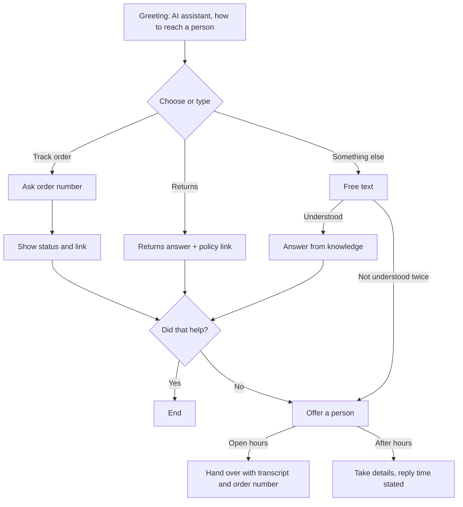

# Conversation flow and hand-over design

## When to use

- A team is flooded with the same ten questions and wants a bot to take the easy ones.
- Customers get stuck in loops or cannot reach a person.
- Hand-overs arrive with no context and customers repeat themselves.
- A business wants a comment-to-DM or lead capture flow on Instagram, Messenger or WhatsApp.

## What you need

1. At least 30 real customer messages from the inbox, chat logs or DMs, with personal details removed.
2. Opening hours, who handles what, and how hand-overs reach them.
3. Policies and facts the bot may use.
4. Channels and tools (website chat, help desk, Meta Business Suite, ManyChat, WhatsApp provider).
5. Where customers are (EU, UK, US states) for disclosure and messaging rules.

Access: level 1 to read existing flows and transcripts; level 2 to build flows in draft; level 3 to publish them.

## Steps

### 1. Sort messages into intents

Group the messages by what the customer wants and count each group. Keep the bot to intents it can answer fully from approved facts. Everything else goes to a person.

### 2. Set hand-over rules

Always to a person: complaints, anything clinical, legal or about money disputes, signs of distress or vulnerability, threats, requests for a person, and two failed attempts to understand. For each rule write what triggers it and who receives it.

### 3. Map the flow

Draw it in Mermaid: greeting, intent choice (buttons plus free text), answer, follow-up ("Did that help?"), fallback after two misses, hand-over, after-hours path and end. Every path must end in an answer or a person.

### 4. Write the bot's words

- **Greeting:** says it is an AI assistant, what it can help with and how to reach a person. Example: "Hi, I'm [Business]'s AI assistant. I can help with orders, delivery and returns. Type 'person' at any time to reach our team."
- **Buttons:** short labels people understand ("Track my order", not "Order status enquiry").
- **Answers:** two or three sentences with a link to the full policy.
- **Not understood:** own it ("I didn't catch that") and offer choices; on the second miss, offer a person.
- **Hand-over:** say what happens next and when ("I'm passing this to our team with our chat so far. We reply within 2 hours, 9am to 5pm.").
- **After hours:** when someone will reply and how to leave details.

### 5. Pass context at hand-over

List what travels with the conversation: transcript, intent, order number or booking reference, what the bot already said, and any form fields collected. In Copilot Studio this is the Transfer conversation step with its variables; in help desks it is usually a note or ticket fields. The person picking up should never ask "How can I help?" after a long bot chat.

### 6. Comment-to-DM and lead flows

- Reply only to people who commented or messaged first, inside the platform's reply window (24 hours on Messenger and WhatsApp).
- Disclose that replies are automated where the law requires it, and as good practice everywhere.
- Ask one or two questions at most, then pass the lead on.
- Say how to stop messages, and honour it.
- No promotional follow-ups to people who have not opted in.

### 7. Write the test script

30 user messages with the expected path and a pass rule each, including typos, slang, off-topic messages, two-intent messages, an angry customer, "are you a bot?", and someone asking for a person on the first message. Hand it to the `chatbot-test-and-review` skill.

### 8. Build and publish

At level 2, build the flow in draft or test mode. At level 3, publish to the agreed channels after the owner approves the test results, and log each change.

## Checks

- The bot says it is an AI in the first message and never claims to be human.
- Every path ends in an answer or a person; no dead ends or endless loops.
- Hand-over rules cover money, health, legal, complaints, distress and explicit requests.
- Context passes at hand-over.
- Answers come only from approved facts.
- Messaging stays within reply windows and opt-in rules.

## Output format

1. Intent table: intent, count, bot answers or hand-over, source
2. Hand-over rules: trigger, receiver, hours, message
3. Mermaid flow map
4. Bot copy: greeting, buttons, answers, fallbacks, hand-over and after-hours lines
5. Context passed at hand-over
6. Channel rules applied (window, opt-in, opt-out)
7. Test script

## Example of good output

*Illustrative structure, not a real business: an online garden supplies shop. Copy the shape, never the content: every fact comes from the client's own context.*

