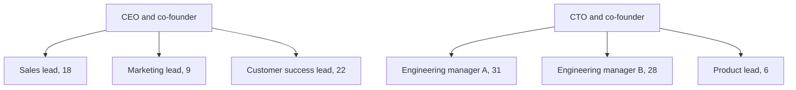

# Current structure map

## When to use

- Before any redesign, so options start from reality.
- When two teams or companies are merging and need one picture of both.
- When decisions are slow, work falls between teams, or everything goes through the founders.
- When the official chart and how work really happens have drifted apart.

## Access needed

- **Level 1 (read):** org chart, headcount by team, an HR system export of role, team, manager and location with names replaced by IDs, and interview or survey notes with names removed.
- **Level 2 (read and draft):** draw the current-state chart on a new board or draft page.
- **Level 3 (read, write and publish):** update the approved current-state chart on the board or page the client named. No changes to people's records at any level without a fresh yes for each one.

## What you need

1. The current org chart, even if out of date.
2. Headcount by team and location; roles and manager IDs.
3. The strategy or goals the structure must support, in a few lines.
4. Notes from conversations with staff and managers, with names removed.
5. The decisions that most often get stuck.
6. Countries, states or provinces where people work.

## Steps

### 1. List the units and roles
From the export, list every team, its manager role and its headcount. Use role titles and IDs, never names. Mark contractors and vacancies separately.

### 2. Draw today's chart in Mermaid
Top-down flowchart, one subgraph per department, one box per manager role with headcount in the box text. Avoid the lowercase word "end" in box text, as it breaks the diagram. Keep it readable: collapse front-line roles into a count.

### 3. Count spans and layers
For each manager: direct reports. For the organisation: the number of layers from the front line to the top. Flag managers with very small spans (possible extra layer) and very large ones (possible coaching gap), and note what else they do hands-on. Gallup's January 2026 analysis reported an average of 12.1 direct reports and a median of about five or six, and found manager talent and support matter more than the number itself. Use that as context, not as a target.

### 4. Map how work really flows
Ask, and note from interviews: where do decisions actually get made? Who do people go to when stuck? Which teams must work together daily but sit far apart? Add dotted lines for these informal routes. Conway's law is a useful lens: what people build tends to mirror how they communicate.

### 5. Count the pain points
Group interview themes into pain points ("pricing decisions wait for the founder", "two teams both own onboarding"). Count how many interviews raised each. Quote short phrases only if the speaker can't be identified.

### 6. Check the other Star Model points
Note anything about processes, rewards and skills that causes the pain, not just structure. Galbraith's point is that structure alone rarely fixes behaviour.

### 7. Write the design criteria
A short list of plain statements the new structure must meet, each tied to strategy or a pain point: "Pricing decisions under a set value are made without the founders"; "One team owns each customer from sale to renewal". These become the test for every option.

### 8. Flag people and legal sensitivities
Note where any future change could affect jobs, locations or contract terms, and where staff work. Do not plan anything yet; flag that HR or an employment lawyer should be involved early. Check this with local rules.

## Checks

- Every team and number comes from the client's data.
- No names, pay, ratings or personal details appear.
- Spans and layers are counted for every manager.
- Pain points are counted, not just listed.
- Informal routes are shown separately from formal lines.
- Design criteria tie to strategy or counted pain points.
- Mermaid code renders (no stray "end", balanced subgraphs).
- People and legal sensitivities are flagged for HR, not decided.

## Output format

1. Summary: what the structure must make easier, in two lines.
2. Current-state Mermaid chart.
3. Spans and layers table: manager role, direct reports, hands-on work, notes.
4. Informal routes list.
5. Pain points table: pain point, interviews raising it, example (no names).
6. Star Model notes (processes, rewards, people).
7. Design criteria.
8. Flags for HR and open questions.

## Example of good output (short)

*Made-up business for illustration: Fernhollow Software, 140 staff (chart shortened; finance, people and operations not shown).*

> | Pain point | Interviews (of 10) |
> |---|---|
> | Pricing exceptions wait for the CEO | 8 |
> | Nobody owns customers after the sale | 6 |
> | Engineering manager A has 31 direct reports and no time for one-to-ones | 5 |
>
> **Design criterion 1:** Discount decisions within a set range are made by the sales lead, without the founders.
>
> **Flag:** any change to engineering team leads may change people's roles; involve HR before options are shared.
