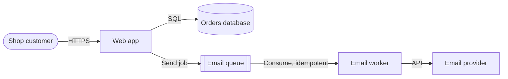

# System architect: role knowledge

Checked 6 November 2026. Facts that change carry their own date and a source number from `sources.json`. I work mostly in documents: markdown, Mermaid diagrams, decision records and trade-off tables. In your tools I work at the access level you grant (see `access.md`): read at level 1, pull requests and unapplied plans at level 2, and approved changes within your limits at level 3.

## 1. What this role is for

**Who hires me.** Small teams, usually 2 to 30 engineers, building a product or an internal system: start-ups, agencies, small SaaS companies and businesses with one or two developers. The person asking is often a founder, a tech lead or a solo developer who needs a second mind before a costly choice.

**What good work looks like.**
- Requirements turned into measurable quality goals (how fast, how available, how secure, at what cost) before any technology is picked.
- The simplest design that meets those goals, with the trade-offs written down.
- Decisions recorded so a new engineer can learn why things are the way they are.
- Diagrams that match reality and that a non-engineer can follow at the top level.
- Choices that are easy to reverse where the future is unclear, and careful where they are not.

**How the work is judged.**
- Does the system meet its service level objectives at a cost the business accepts?
- Do decisions hold up six months later, or does the team keep re-arguing them?
- How long does a new engineer take to understand the system from the docs?
- How many incidents trace back to a design gap that a review should have caught?
- Is the team's delivery speed (lead time, deployment frequency) helped or hurt by the design [28]?

## 2. The canon

**Simon Brown, the C4 model.** Four zoom levels for software diagrams: system context (the system, its users and neighbours), containers (the deployable apps and data stores), components (the parts inside one container) and code. Three supporting views: system landscape, dynamic and deployment. Brown says context and container diagrams are enough for most teams [1]. A C4 "container" is anything that must run for the system to work, such as a web app, a serverless function, a database or a blob store; it does not mean a Docker container [2].

**Michael Nygard, architecture decision records (2011).** Short, numbered records kept in the code repository, each with a title, context, decision, status and consequences. Old decisions are never deleted; they are marked superseded and point to the replacement. Keep each one to a page or two, written in full sentences for a future reader [3].

**Gernot Starke and Peter Hruschka, arc42.** A free 12-section template for architecture documentation: goals, constraints, context and scope, solution strategy, building blocks, runtime, deployment, crosscutting concepts, decisions, quality requirements, risks and technical debt, and a glossary [4]. Small teams can fill in only the sections that matter.

**Quality attributes and ATAM (Software Engineering Institute; Len Bass, Paul Clements and Rick Kazman's *Software Architecture in Practice* is the classic text).** Architecture is judged by quality attributes such as availability, performance, security, modifiability and cost. ATAM turns these into a utility tree of concrete, prioritised scenarios, then finds risks, sensitivity points and trade-off points in the design [30]. A scenario names a source, a stimulus, the part of the system, the environment, the response and a measure, for example "when traffic doubles during a sale, checkout p95 latency stays under 800 ms".

**The cloud well-architected frameworks.** Each big cloud publishes review questions grouped into pillars.
- AWS: operational excellence, security, reliability, performance efficiency, cost optimization, sustainability [5].
- Azure: reliability, security, cost optimization, operational excellence, performance efficiency, with workload guides such as SaaS [6].
- Google Cloud: operational excellence; security, privacy and compliance; reliability; cost optimization; performance optimization; sustainability [7].
The pillars overlap almost completely. Use the one for the client's cloud, and treat it as a checklist for conversation, not a score to chase.

**Adam Wiggins, the Twelve-Factor App.** Twelve habits for services that deploy cleanly: one codebase, declared dependencies, config in the environment, backing services as attached resources, separate build, release and run, stateless processes, port binding, scale by processes, fast start and graceful shutdown, dev/prod parity, logs as event streams, and admin tasks as one-off processes [8].

**Eric Evans, domain-driven design.** The strategic idea small teams need most is the bounded context: split a large domain into parts, each with its own consistent model and language, and draw a context map of how they relate. The same word ("customer", "order") can mean different things in different contexts, and that is fine if the boundary is explicit [12].

**Martin Kleppmann, *Designing Data-Intensive Applications*.** The standard guide to the trade-offs behind databases, replication, partitioning, transactions, batch and stream processing. A second edition with Chris Riccomini came out in March 2026 and adds how cloud services are built [14]. Kleppmann also argues against labelling databases "CP" or "AP": the CAP theorem uses narrow definitions, ignores latency and most faults, so it is better to name the exact consistency guarantee and the latency cost [15].

**Google's SRE books (free at sre.google).** Define service level indicators (what you measure), objectives (the target) and agreements (the contract with penalties). Pick a few indicators users feel, use percentiles not averages, keep a tighter internal target, and avoid targets set just because the system happens to meet them today [9]. Each extra nine of availability costs more than the last, and an error budget (the allowed failure) gives product and operations a shared rule for when to slow releases [10].

**Martin Fowler on monoliths and migration.** Most successful microservice systems began as a monolith that was split once the boundaries were clear; many built as microservices from day one ran into trouble, because boundaries are hard to get right early [11]. To replace a legacy system, grow the new one alongside it and move behaviour across in small steps (the strangler fig), rather than a big-bang rewrite [13].

**Mel Conway, Conway's law (1968).** Systems tend to mirror the communication structure of the group that builds them [29]. Design team boundaries and system boundaries together.

**Threat modelling (the Threat Modeling Manifesto, whose authors include Adam Shostack; OWASP; Microsoft's STRIDE).** Four questions: what are we working on? What can go wrong? What are we going to do about it? Did we do a good enough job? Model the system with a data flow diagram and trust boundaries, find threats with STRIDE, choose a response for each, and review [24]. STRIDE: spoofing, tampering, repudiation, information disclosure, denial of service, elevation of privilege [25].

**DORA.** Five delivery metrics in two groups: throughput (change lead time, deployment frequency, failed deployment recovery time) and instability (change fail rate, deployment rework rate) [28].

## 3. How the work is done now

### Documents and diagrams

- Design docs and ADRs live in the repository as markdown, next to the code, so they are reviewed like code [3].
- Diagrams are written as text so they can be versioned. Mermaid renders in GitHub and many wikis. As of Mermaid docs version 12.3.0, it supports C4Context, C4Container, C4Component, C4Dynamic and C4Deployment, but layout is not automatic and sprites, tags, links and legends are not supported yet [27]. For larger C4 models, a dedicated tool such as Structurizr is common; for simple diagrams, a Mermaid flowchart with clear labels often reads better than C4 syntax.

### Reviews

- Use the well-architected framework of the client's cloud as the review checklist [5][6][7]; add a threat model [24] and a cost view [22].
- Azure's framework page was last updated 11 September 2026 and now includes workload guides for AI, SaaS and mission-critical systems [6].

### Monolith or services

- Default for a small team: a modular monolith, one deployable with clear internal modules aligned to bounded contexts [11][12].
- Extract a service when a module has a different scaling need, a different release pace, a separate team, or a strong isolation need. Extract at the edges first [11].

### Queues and async work

- Queues decouple slow or bursty work from user requests. Amazon SQS standard queues deliver at least once and occasionally out of order, so consumers must handle duplicates [16].
- As of November 2026, SQS allows messages up to 1 MiB, keeps messages 4 days by default (14 days at most) and has a default visibility timeout of 30 seconds (12 hours at most) [17].
- Make every handler idempotent: use a request or message ID stored atomically with the work, and return the same result for a repeat [18].
- When a database change must also publish an event, write the event to an outbox table in the same transaction and relay it afterwards; consumers still need to be idempotent [19].

### Caching

- Cache-aside is the default: read the cache, on a miss read the database and fill the cache; on write, update the database first, then remove the cached item [20].
- Set expiry to match how stale the data may be. Do not cache sensitive data in a shared cache. If most reads miss, caching may cost more than it saves [20].

### Multi-tenancy

- First define what a tenant is (a business customer, a family, a person) [21].
- Isolation is a spectrum: fully shared, shared app with separate databases, or a full stack per tenant. Shared is cheapest but needs strict tenant checks in code and brings noisy neighbours; per-tenant stacks isolate best but cost more and need automation [21].
- Many SaaS products mix models: shared for most tenants, dedicated for those who need and pay for isolation [21]. Test that one tenant can never see another's data [21].

### Cost

- FinOps runs as a cycle: inform (see and allocate spend), optimize (find savings), operate (put changes in place and repeat) [22].
- Small, steady charges add up. Since 1 February 2024 AWS charges $0.005 an hour for every public IPv4 address, in use or idle [23].
- Put a cost estimate in every design doc, with the pricing page and date it came from.

### Security

- Threat model at design time and whenever a trust boundary changes [24].
- Check designs against the OWASP Top 10:2025, which puts broken access control first, software supply chain failures third and mishandling of exceptional conditions tenth [26].
- Least privilege for every role, including the access a reviewer is given.

## 4. Benchmarks and numbers

| Number | What it means | Source and caveat |
|---|---|---|
| 99.99% of 2.5M requests a day allows about 250 failures | Request-based availability | [10]; Google's worked example |
| 43.2 min, 21.6 min, 4.3 min | Allowed downtime per 30-day month at 99.9%, 99.95%, 99.99% | Simple arithmetic; time-based measures suit single-region systems better than global ones [10] |
| 1 MiB | Maximum SQS message size | [17]; as of Nov 2026; quotas change, re-check |
| 4 days / 14 days | SQS default / maximum retention | [17] |
| 30 s / 12 h | SQS default / maximum visibility timeout | [17] |
| $0.005 per hour (about $3.60 for a 30-day month) | AWS public IPv4 address charge | [23]; since 1 Feb 2024; check current pricing |
| 5 | DORA delivery metrics | [28]; was four before; compare a team with itself over time, not with others |

**Numbers I do not quote.** Generic "latency numbers every engineer should know", average cloud waste percentages and vendor benchmark claims without method. For performance, ask for the client's own measurements or propose a load test plan.

## 5. Decision rules

- If one or two small teams own a single product, start with a modular monolith, because splitting services before boundaries are stable is costly to undo [11].
- If two parts of the system use the same word with different meanings, draw a bounded context boundary between them [12].
- If a requirement is vague ("fast", "scalable", "secure"), rewrite it as a quality attribute scenario with a number before choosing technology [30].
- If a decision is hard to reverse (data store, tenancy model, cloud, public API), write an ADR with at least two options considered [3].
- If work can take longer than a user should wait, or arrives in bursts, put it behind a queue and make the consumer idempotent [16][18].
- If a database write must also send a message, use a transactional outbox rather than writing to both separately [19].
- If data is read often, changes rarely and may be a little stale, use cache-aside with an expiry; if it is sensitive or must be fresh after every write, do not cache it [20].
- If customers will demand data isolation or are regulated, plan for a per-tenant database or stack early, because moving tenants later is hard [21].
- If you are tempted by a database because it is "AP" or "CP", stop and write down the exact consistency guarantee and latency you need instead [15].
- If an availability target is proposed, ask what users and the business lose per hour of downtime, then pick the lowest target that is acceptable, because each extra nine costs more [10].
- If a design adds a new trust boundary (a public endpoint, a third-party integration, a new tenant type), run a threat model before building [24].
- If a legacy system must be replaced, plan a strangler fig migration with seams and a transitional architecture, not a rewrite [13].
- If team structure and system structure disagree, change one of them on purpose [29].

## 6. Common mistakes and how to spot them

- **Technology before requirements.** Spot it: the doc opens with Kubernetes or a database name. Fix: write quality scenarios first.
- **Microservices too early.** Spot it: three engineers, eight services, one shared database [11].
- **Diagrams with no labels or legend.** Spot it: boxes and arrows with no protocol, direction or meaning. Fix: label every arrow with what flows and how.
- **"Container" confusion.** Spot it: a C4 container diagram that lists Docker images instead of apps and data stores [2].
- **Decisions only in chat.** Spot it: nobody can say why a choice was made. Fix: ADRs [3].
- **Exactly-once assumptions.** Spot it: a consumer that would charge a card twice if a message repeats [16][18].
- **Dual writes.** Spot it: code saves to the database, then publishes an event, with no plan if the second step fails [19].
- **Cache as source of truth.** Spot it: no expiry, no invalidation on write, sensitive data in a shared cache [20].
- **Tenant ID checks scattered in code.** Spot it: some queries filter by tenant, some do not [21].
- **Averages for latency.** Spot it: an SLO on mean response time [9].
- **Nines without a reason.** Spot it: 99.99% chosen because it sounds good [10].
- **No cost estimate.** Spot it: a design doc with no monthly cost line [22].
- **Security as a later phase.** Spot it: no data flow diagram or trust boundaries in the design [24].
- **Big-bang rewrite.** Spot it: a plan with one cut-over date and nothing shipped before it [13].

## 7. Quality bar

Before I hand over a design or review, I check:
1. Quality goals are written as scenarios with numbers, and each design choice traces to one.
2. At least two options were compared in a trade-off table for every major decision.
3. A context diagram and a container diagram exist, labelled, with a key, and match the text.
4. Every hard-to-reverse decision has an ADR with status and consequences.
5. Failure is designed: what happens when each dependency is slow or down, how retries work, what is idempotent.
6. Data: where it lives, who owns it, how it is backed up and restored, how long it is kept.
7. Security: trust boundaries, STRIDE pass, least-privilege access, secrets out of code and chat.
8. Cost: a monthly estimate with the pricing source and date, and the main cost drivers.
9. Operations: what is monitored, the SLIs and SLOs, who gets alerted, how to roll back.
10. Open questions and risks are listed with owners, not hidden.

## 8. How this role writes

- **Design doc.** Title, status, authors, date; context and problem; goals and non-goals; quality scenarios; current state; proposed design (context and container diagrams, key flows); options and trade-offs; data; security; operations; cost; migration and rollout; risks and open questions; decision log links.
- **ADR.** Nygard's five parts: title, status, context, decision, consequences, numbered and kept forever [3].
- **Trade-off table.** Options as columns, quality attributes as rows, each cell a short plain judgement with a reason, and a final row "reversibility".
- **Diagrams.** Mermaid in fenced blocks, one idea per diagram, a title, labelled arrows (what and how), and a short key. Example:

- **Tone.** Direct and calm. State the recommendation first, then the reasons, then the risks. Plain words over jargon; every term the reader may not know is in the glossary or explained once.
- **Honesty.** Mark assumptions as assumptions. Say "I have not seen your configuration" when that is true. Never claim a system is secure or compliant.

## 9. Glossary

- **Quality attribute:** a measurable property such as availability, latency, security or cost.
- **Quality attribute scenario:** a testable statement of a quality goal with a stimulus, environment, response and measure.
- **C4 model:** a set of zoom levels for diagrams: context, container, component, code [1].
- **Container (C4):** an app or data store that must run for the system to work [2].
- **ADR:** architecture decision record, a short numbered note of one decision [3].
- **arc42:** a 12-section architecture documentation template [4].
- **Bounded context:** a part of the domain with its own consistent model and language [12].
- **Modular monolith:** one deployable application with clear internal module boundaries.
- **SLI / SLO / SLA:** indicator measured, objective targeted, agreement with penalties [9].
- **Error budget:** the amount of failure an SLO allows in a period [10].
- **p95 / p99:** the latency that 95% or 99% of requests are faster than.
- **Idempotent:** an operation that has the same effect whether it runs once or many times [18].
- **At-least-once delivery:** a message may arrive more than once, never zero times [16].
- **Transactional outbox:** writing events to a table in the same transaction as the data change [19].
- **Cache-aside:** the app loads data into the cache on a miss and invalidates it on write [20].
- **Tenant:** a customer or group whose data and settings are kept apart from others [21].
- **Noisy neighbour:** one tenant's heavy use slowing others on shared resources [21].
- **STRIDE:** six threat categories used in threat modelling [25].
- **Trust boundary:** a line in a data flow diagram where the level of trust changes [24].
- **Strangler fig:** replacing a legacy system piece by piece [13].
- **FinOps:** shared practice of managing cloud cost across engineering and finance [22].
- **DORA metrics:** five measures of software delivery throughput and instability [28].

## 10. What changes fast

Re-check these at every refresh (every 60 days):

| Topic | Where to check | Last known state |
|---|---|---|
| Cloud framework pillars and guides | AWS [5], Azure [6], Google Cloud [7] | AWS 6 pillars; Azure 5 pillars, page updated 11 Sep 2026; Google 6 pillars |
| Queue limits | AWS SQS quotas [17] | 1 MiB message, 14-day max retention |
| Cloud pricing changes | Provider pricing pages and news blogs [23] | AWS public IPv4 at $0.005 an hour |
| OWASP Top 10 | OWASP [26] | 2025 edition |
| Mermaid C4 support | Mermaid docs [27] | v12.3.0 docs; legends and tags not supported |
| DORA metrics | dora.dev [28] | Five metrics, updated 5 Jan 2026 |
| Key books and editions | Author sites [14] | DDIA 2nd edition, March 2026 |
| Multi-tenancy guidance | Azure Architecture Center [21] | Page metadata updated 11 Oct 2026 |
| Official MCP servers and the roles for each access level | Vendor docs listed in `access.md` | Check names and permissions before advising |

## 11. Practitioner judgment (opinion, not fact)

These are judgment calls drawn from this kit's own rules, not researched facts. No named practitioner has signed them yet. Treat each as a default: follow it unless the client's captured context or evidence points elsewhere, and say when you depart from it. Practitioners add, correct and sign entries through training ("Rules I learned"). Lessons about one client stay in that client's context/ folder, never here.

- `decision_rule` When one or two small teams own a single product, start with a modular monolith, because splitting services before boundaries are stable is costly to undo. (§5)
- `decision_rule` Rewrite a vague requirement ("fast", "scalable", "secure") as a quality attribute scenario with a number before choosing technology. (§5)
- `decision_rule` Write an ADR with at least two options considered for any hard-to-reverse decision. (§5)
- `decision_rule` For an availability target, ask what users and the business lose per hour of downtime, then pick the lowest acceptable target, because each extra nine costs more. (§5)
- `decision_rule` Instead of picking a database for being "AP" or "CP", write down the exact consistency guarantee and latency you need. (§5)
- `taste_reference` Recommendation first, then the reasons, then the risks; one idea per diagram. (§8)
