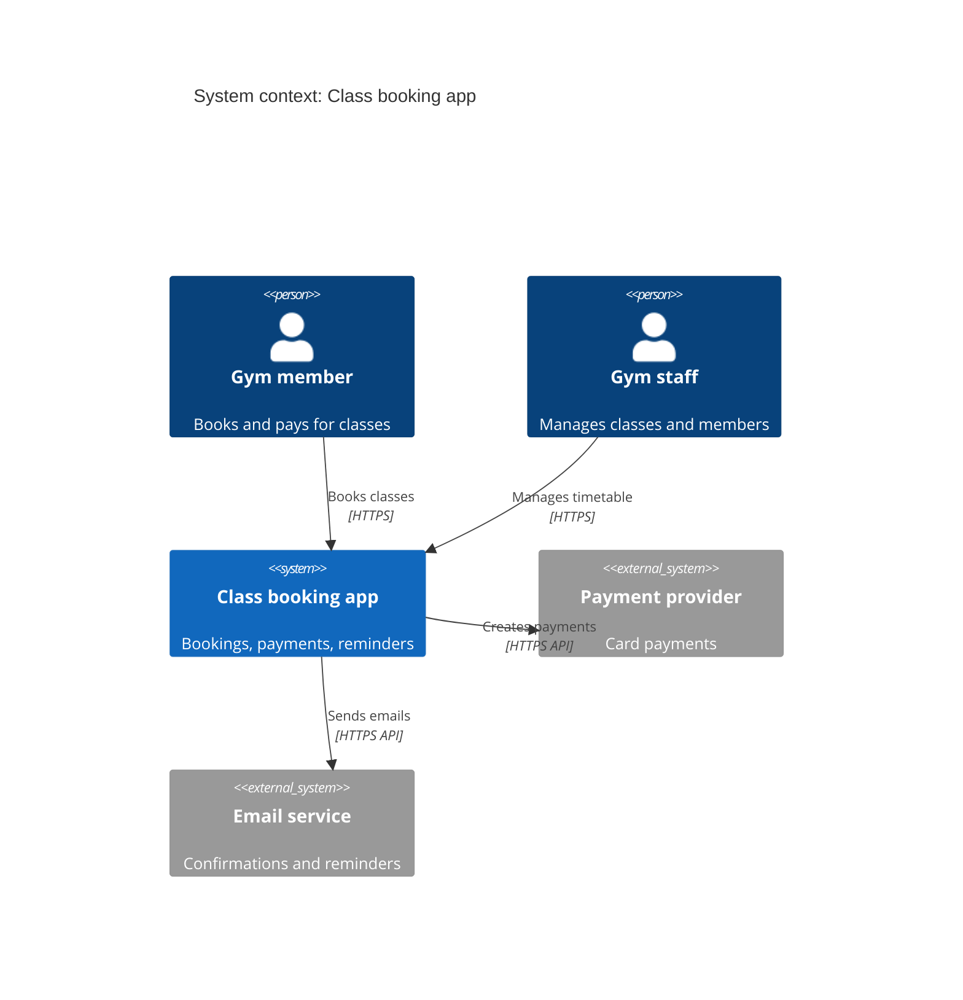
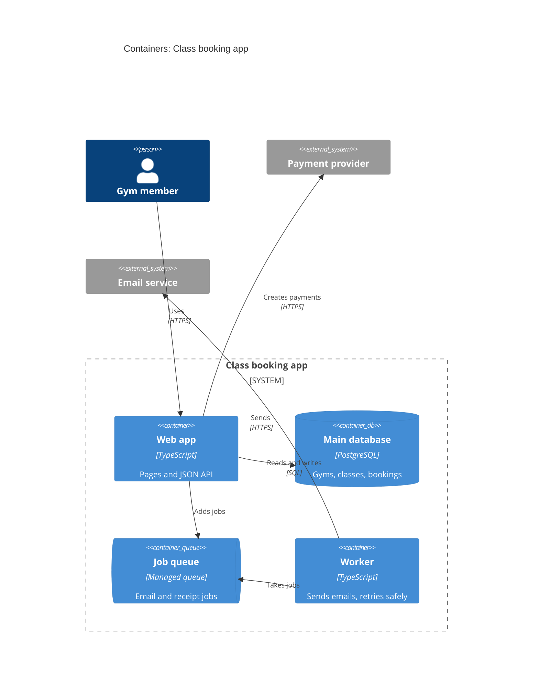
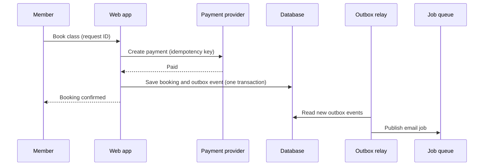

# System design doc

## When to use

- A new product, service or integration is about to be built.
- A major change: new data store, new tenancy model, splitting a service, moving cloud.
- The team argues about how the system works because nobody has drawn it.
- An investor, client or new tech lead asks "how does it work?"

## What you need

Ask for these; mark anything missing as an assumption.

1. The problem and who it is for (users, customers, internal teams).
2. Goals and non-goals for the next 6 to 12 months.
3. Expected load: users, requests or jobs per day, peaks, data size and growth.
4. Constraints: team size and skills, cloud already in use, budget, deadlines, regulations, data location.
5. The current system, if any: a repo link or a description, existing diagrams, a list of services and databases.
6. What "down" costs the business per hour, and any promised uptime.

**Access:** level 1 to read the current system, repo and costs; level 2 to open a pull request with the design doc and ADRs and to draft tickets for the build; level 3 to merge the approved pull request and create the agreed tickets, within your limits. Building and deploying the system is a separate job with its own limits.

## Steps

### 1. Write quality attribute scenarios

Turn every adjective into a testable scenario with a number:

| Attribute | Scenario |
|---|---|
| Performance | When 200 users book at once on Monday 9am, p95 booking time stays under 1 second. |
| Availability | Booking works 99.9% of requests each month, measured at the load balancer. |
| Security | Staff of one gym can never see another gym's members. |
| Modifiability | A new payment provider can be added in under two weeks by one engineer. |
| Cost | Hosting stays under $400 a month at 10,000 bookings a month. |

Rank them. The top three drive the design.

### 2. Draw the system context (C4 level 1)

Show the system as one box, its users and the outside systems it talks to. Label every arrow with what flows and how.



### 3. Draw the containers (C4 level 2)

A C4 container is an app or data store that must run for the system to work (a web app, a worker, a database, a queue, a bucket), not a Docker container.



Mermaid's C4 layout is not automatic and it does not draw legends yet, so add a short key under each diagram in text. If the C4 syntax gets crowded, a plain Mermaid flowchart with labelled arrows is fine.

Draw component diagrams (level 3) only for a container that is complex or risky. Skip code diagrams.

### 4. Show the key flows

For the two or three flows that matter most (often sign-up, the main transaction, and a failure case), draw a sequence diagram.



### 5. Compare options

For each major choice, compare at least two options against the top quality scenarios.

| | Option A: modular monolith | Option B: three services |
|---|---|---|
| Performance | Fine at expected load | Fine, adds network hops |
| Availability | One deploy to keep healthy | More parts that can fail |
| Modifiability | Clear modules, one repo | Independent deploys |
| Cost | One app, one database | More hosting and tooling |
| Team fit | Two engineers can run it | Needs more ops skill |
| Reversibility | Can extract services later | Hard to merge back |

State the recommendation and why. Write an ADR for each hard-to-reverse decision (use the `architecture-decision-record` skill).

### 6. Fill in the cross-cutting sections

- **Data:** each store, what it holds, owner, backup and restore, retention, personal data.
- **Failure:** for each dependency, what happens when it is slow or down; timeouts, retries with backoff, idempotency, queues.
- **Security:** trust boundaries, authentication, authorisation (including tenant checks), secrets handling, a short STRIDE pass (or the `threat-model` skill for anything exposed to the internet).
- **Operations:** SLIs and SLOs, dashboards, alerts and who receives them, deploy and rollback.
- **Cost:** monthly estimate by line item, with the pricing page and date used.
- **Rollout:** steps, feature flags, data migration, how to go back.

### 7. List risks and open questions

Each with an owner and a date. Never hide an unknown.

## Checks before handing over

- Every design choice traces to a ranked scenario.
- Context and container diagrams render, have titles, labelled arrows and a text key, and match the prose.
- At least one failure flow is shown.
- Every hard-to-reverse choice has an ADR link.
- Cost has a number, a source and a date.
- Assumptions are marked as assumptions.
- No secrets, keys or real customer data appear anywhere in the doc.

## Output format

```text
# [System] design
Status: draft | in review | accepted   Authors:   Date:
1. Context and problem
2. Goals and non-goals
3. Quality attribute scenarios (ranked)
4. System context diagram
5. Container diagram
6. Key flows
7. Options and trade-offs, recommendation
8. Data
9. Failure handling
10. Security
11. Operations
12. Cost
13. Rollout and migration
14. Risks and open questions
15. Decision records (links)
```

## Example of good output (short)

> **Recommendation:** Build one modular web app with a PostgreSQL database and a managed queue for emails. With two engineers and 10,000 bookings a month, separate services would add cost and failure points without meeting any scenario better. Module boundaries follow the three contexts (timetable, bookings, billing), so billing can be split out later if a second payment flow appears. See ADR-003.
