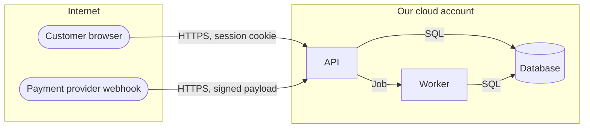

# Threat model

## When to use

- A new feature crosses a trust boundary: a public endpoint, a webhook, a file upload, a third-party API, a new kind of user or tenant.
- An AI agent or automation is being given tools, data access or the ability to act.
- A client sends a security questionnaire and the team wants to know its real gaps.
- After a security incident, to find related weaknesses.

This is defensive design. I do not write exploit code, scan systems or test anything live.

## What you need

1. What is being built: a short description, a diagram or design doc.
2. Who uses it and what they can do (roles, tenants, admins, machines).
3. The data involved and how sensitive it is (personal data, payments, health, secrets).
4. Third parties and where they connect.
5. Existing controls: authentication method, authorisation model, logging, encryption.

**Access:** level 1 to read designs, configs and access settings; level 2 to open a pull request with the threat model and to draft tickets for the mitigations; level 3 to merge it and create the agreed tickets, within your limits. Changing live security settings is never part of this skill.

## Steps

### 1. What are we working on?

Draw a data flow diagram: external entities, processes, data stores, data flows, and trust boundaries where the level of trust changes. In Mermaid, use subgraphs for boundaries.

### 2. What can go wrong?

Walk STRIDE across every flow that crosses a boundary:

| Letter | Threat | Property broken | Example question |
|---|---|---|---|
| S | Spoofing | Authentication | Can someone pretend to be the webhook sender? |
| T | Tampering | Integrity | Can a request change another tenant's record? |
| R | Repudiation | Non-repudiation | Can an admin action happen with no log? |
| I | Information disclosure | Confidentiality | Can an error page or export leak data? |
| D | Denial of service | Availability | Can one user's upload stall everyone? |
| E | Elevation of privilege | Authorisation | Can a normal user reach an admin route? |

Then check the design against the OWASP Top 10:2025 headings: broken access control, security misconfiguration, software supply chain failures, cryptographic failures, injection, insecure design, authentication failures, software or data integrity failures, security logging and alerting failures, mishandling of exceptional conditions.

For AI agents with tools, add: what can the agent do if its input contains instructions from an attacker (prompt injection)? Which actions need a human to approve?

### 3. What are we going to do about it?

For each threat choose one response: mitigate, eliminate (remove the feature or data), transfer (to a provider or insurer, which does not remove the risk) or accept. Record who accepted any risk. Rank by likelihood and impact.

Typical mitigations to consider:
- Verify webhook signatures and reject unsigned calls.
- Enforce tenant and role checks in one place; test that cross-tenant access fails.
- Validate and limit uploads (size, type, scanning) and process them off the request path.
- Keep secrets in a secrets manager, never in code, tickets or chat.
- Log security-relevant actions with who, what and when; alert on the unusual ones.
- Pin and scan dependencies; protect the build pipeline.
- Fail closed: an error must not grant access.

### 4. Did we do a good enough job?

Review the model with the team: is the diagram accurate, is every boundary covered, does each threat have a response and an owner, can each mitigation be tested? Set a date to update the model when the design changes.

## Checks before handing over

- The diagram shows every trust boundary and is confirmed by the team.
- Each boundary-crossing flow has a STRIDE pass.
- Each threat has a response, an owner and a rank.
- Accepted risks are named with who accepted them.
- Mitigations are testable (a test, a config check, a log query).
- The report does not claim the system is "secure"; it lists what was and was not covered.
- No secrets, keys or real personal data appear in the document.

## Output format

1. Scope and assumptions
2. Data flow diagram (Mermaid) with trust boundaries
3. Threat table: ID, flow, STRIDE letter, threat, likelihood, impact, response, mitigation, owner
4. OWASP Top 10:2025 notes
5. Accepted risks
6. Tests to prove the mitigations
7. Review date

## Example of good output (short)

> | ID | Flow | STRIDE | Threat | L | I | Response | Mitigation | Owner |
> |---|---|---|---|---|---|---|---|---|
> | T1 | Webhook to API | S | Anyone can post a fake "payment succeeded" event | High | High | Mitigate | Verify the provider's signature and timestamp; reject on failure; test with an unsigned payload | Lead dev |
> | T2 | API to DB | E | Report endpoint skips tenant filter | Medium | High | Mitigate | Central tenant scope plus row-level security; cross-tenant test per endpoint | Lead dev |
> | T3 | Upload | D | 2 GB upload ties up the API | Medium | Medium | Mitigate | 20 MB limit at the edge; process in the worker | Ops |
