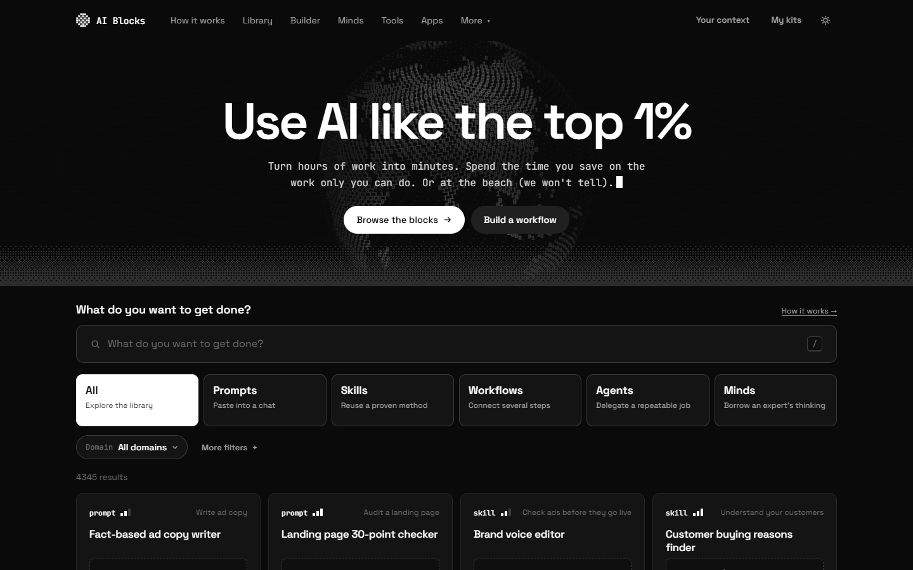
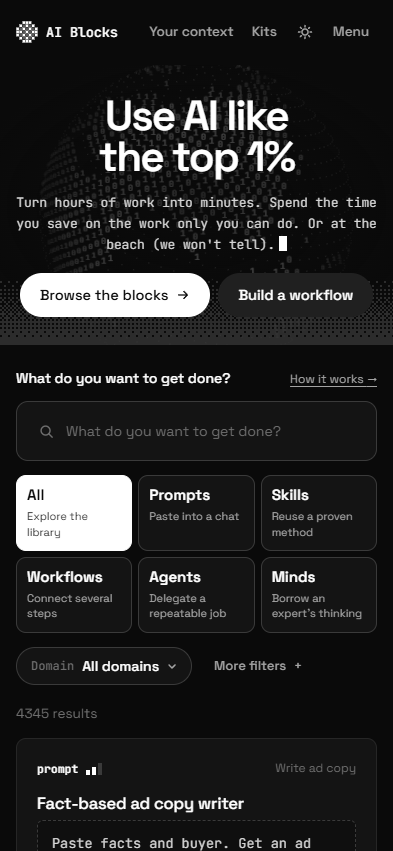

# Library navigation simplification, 21 October 2026

The library now starts with one goal search and six visible format tiles: All, Prompts, Skills, Workflows, Agents and Minds. Each tile explains how to use that format. Domain is the primary dropdown. Work, Task and Level appear under More filters; its badge indicates active secondary filters while collapsed.

Removed the repeated search, maker filter, domain chip row, work-card carousel and task-chip row. Maker credit remains on imported cards and detail pages. Existing domain, work, task, format and level links still work. Legacy maker parameters are removed so an invisible maker selection cannot hide results. The search now normalizes hyphens and underscores in the query as it already did in catalogue text.

## Validation

- TypeScript compilation, Vite production build and prerender passed: 4,464 pages, 63 job hubs, 16,315 output files.
- 59 affected desktop/mobile Playwright cases passed across the regression run and focused reruns. The first run passed 56; reruns passed the corrected hyphenated-name search, one workflow-download timeout, and a test whose title changed during discovery.
- Production smoke checks at 320, 393, 768 and 1440 pixels passed: all six formats fit, domain and work menus stay on screen, search combines with domain/format, reload preserves selections, and no page errors or document overflow occurred.
- Keyboard checks cover format arrows/Home/End and existing dropdown navigation. Secondary filter state is retained, indicated when collapsed, restored on reload and cleared by Clear all.
- New navigation copy reads at grade 6.8 using the repository reading-level tool.
- Whitespace validation passed.

Production observations: [library-simplification-smoke.json](library-simplification-smoke.json).

